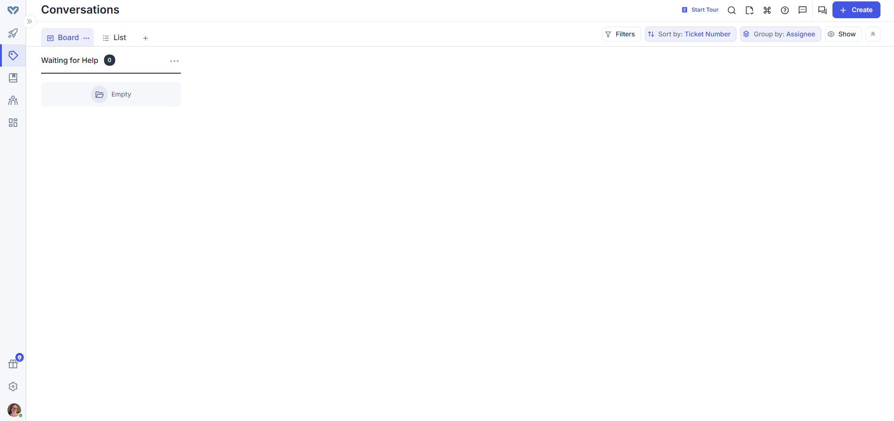
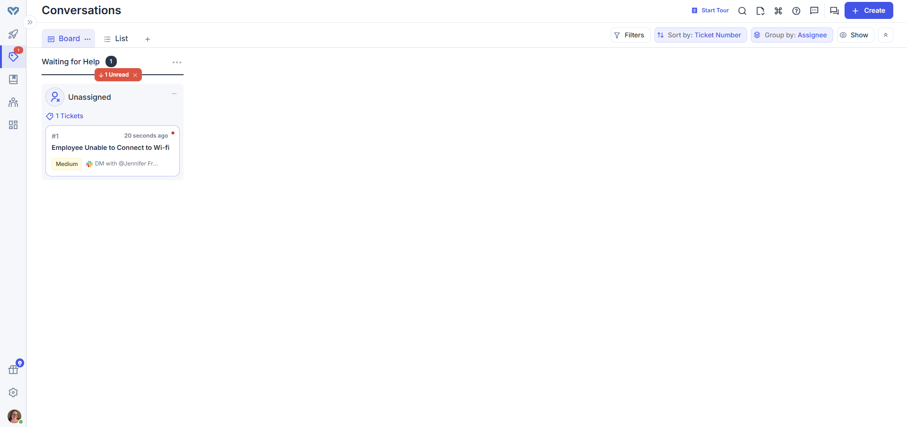
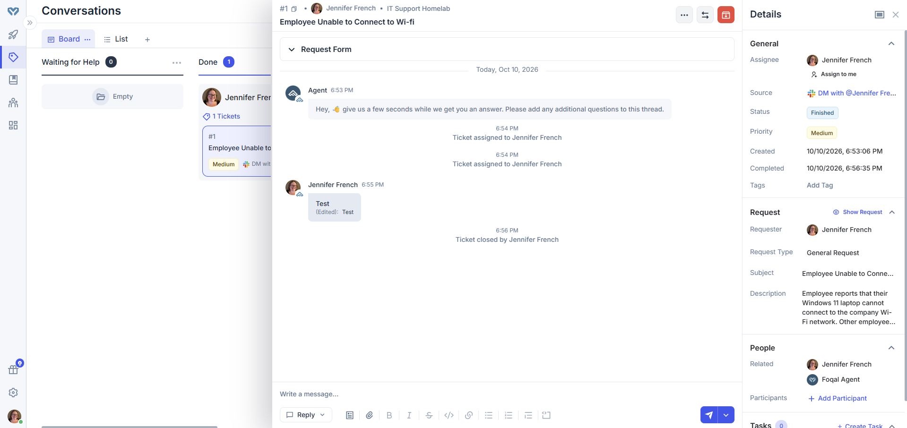

# Foqal IT Help Desk Ticketing Lab

## Overview

This project documents my hands-on experience using **Foqal**, an IT help desk and ticket management platform that integrates with Slack.

I configured a Foqal test environment connected to my Slack workspace and practiced the complete lifecycle of a simulated IT support ticket, from creation and assignment through communication and closure.

The goal was to become familiar with ticket management workflows commonly used by internal IT support teams.

## Technologies Used

- Foqal Ticketing System
- Slack
- Web-Based Help Desk Administration
- Windows 11 (simulated troubleshooting scenario)

---

## Lab 1 — Foqal Help Desk Dashboard

After completing the initial Foqal setup, I accessed the Conversations dashboard.

The dashboard provides a centralized interface for viewing and managing employee support requests.

### Tasks Completed

- Connected Foqal to a Slack test workspace
- Configured a Slack-based support channel
- Explored the Conversations dashboard
- Reviewed the ticket board and available views
- Identified the queue used to manage incoming requests

### Screenshot — Foqal Conversations Dashboard

---

## Lab 2 — Creating an IT Support Ticket

I created a simulated help desk ticket involving an employee who could not connect to the company Wi-Fi network.

### Ticket Details

**Subject:** Employee Unable to Connect to Wi-Fi

**Request Type:** General Request

**Priority:** Medium

**Description:** An employee reported that their Windows 11 laptop could not connect to the company Wi-Fi network, although other employees were able to connect.

### Tasks Completed

- Created a new ticket
- Selected the appropriate request type
- Entered a descriptive subject
- Documented the reported problem
- Assigned a Medium priority
- Verified that the ticket appeared in the support queue

### Screenshot — New IT Support Ticket

---

## Lab 3 — Ticket Assignment and Communication

After creating the ticket, I opened it and assigned it to myself as the responsible support technician.

I also practiced entering a message in the ticket conversation.

### Tasks Completed

- Opened an existing support ticket
- Assigned the ticket to myself
- Reviewed ticket ownership
- Used the conversation interface to enter a test message
- Reviewed ticket details and status information

This exercise focused on learning the ticketing interface rather than performing an actual Wi-Fi repair.

---

## Lab 4 — Closing the Support Ticket

After practicing ticket assignment and communication, I changed the ticket status to Closed.

Foqal moved the ticket from the active support queue into the Done column.

### Tasks Completed

- Reviewed the ticket's assigned status
- Changed the ticket status to Closed
- Located the completed ticket
- Verified the Finished status
- Reviewed the ticket's activity history and completion details

### Screenshot — Completed IT Support Ticket

---

## Skills Practiced

- IT Help Desk Ticketing
- Ticket Creation and Documentation
- Ticket Assignment
- Support Request Prioritization
- Ticket Status Management
- Help Desk Communication
- Ticket Closure
- Slack Integration
- IT Support Workflow Management

---

## Key Takeaways

This lab provided hands-on experience with Foqal's ticket management interface and the process of managing support requests.

I practiced creating tickets, assigning responsibility, communicating through ticket conversations, reviewing ticket activity, and closing completed requests.

The lab helped me become more comfortable with structured IT help desk workflows and Slack-integrated support tools.

**Note:** This was a simulated ticket management exercise. No actual employee device or network issue was diagnosed or repaired.
